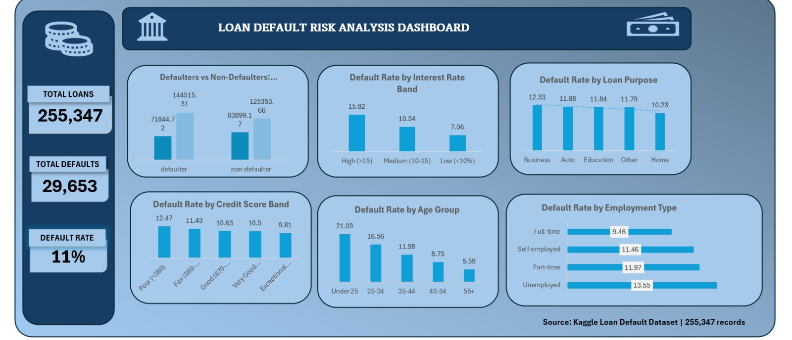

# 🏦 Loan Default Risk Analysis Dashboard

**Tools:** PostgreSQL · Microsoft Excel  
**Dataset:** [Loan Default Dataset – Kaggle](https://www.kaggle.com/datasets/nikhil1e9/loan-default)  
**Records analysed:** 255,347 loan applications  
**Author:** Emmanuel Enuodu | [LinkedIn](https://www.linkedin.com/in/enuodu-emmanuel/) | [GitHub](https://github.com/EmmyPearl)

---

## 📊 Dashboard Preview

*Multi-panel Excel dashboard showing default rate by interest rate band, credit score band, age group, employment type, and loan purpose.*

---

## 📌 Project Overview

This project analyses 255,347 personal loan applications to identify the key factors that predict whether a borrower will default. The findings are designed to help banks and financial institutions make more informed lending decisions and reduce credit risk exposure.

The full pipeline covers data import and integrity checks in PostgreSQL, 8 targeted SQL queries across risk dimensions, and a professional multi-panel Excel dashboard with KPI cards and 6 charts.

---

## 🎯 Business Questions Answered

- What is the overall loan default rate?
- Which borrower age groups carry the highest default risk?
- Does employment type affect the likelihood of default?
- How do income and loan amount differ between defaulters and non-defaulters?
- Which loan purposes are riskiest?
- How reliable is credit score as a standalone risk predictor?
- Does a higher interest rate correlate with higher default rates?

---

## 🗂️ Dataset

| Column | Description |
|--------|-------------|
| `Age` | Borrower's age |
| `Income` | Annual income |
| `LoanAmount` | Total loan value |
| `CreditScore` | Borrower's credit score |
| `EmploymentType` | Full-time, Part-time, Self-employed, Unemployed |
| `LoanPurpose` | Business, Auto, Education, Home, Other |
| `InterestRate` | Loan interest rate (%) |
| `Default` | 1 = defaulted, 0 = did not default |

---

## 🛠️ Methodology

### Step 1 — Data Import & Exploration (PostgreSQL)
- Imported CSV into PostgreSQL and created a structured `loans` table
- Verified data integrity: checked row counts and null values across key columns
- Explored data distributions using `LIMIT`, `COUNT`, and aggregation checks

### Step 2 — SQL Analysis
Wrote 8 analytical queries covering:
- Overall default rate calculation
- Default rate segmented by age group, employment type, loan purpose, credit score band and interest rate band
- Average income and loan amount comparison between defaulters and non-defaulters
- High-risk combined segments (age + employment type)

### Step 3 — Excel Dashboard
- Exported all query results from PostgreSQL to Excel as CSVs
- Built a structured workbook with one sheet per query result
- Created a professional dashboard with KPI cards and 6 charts

---

## 📊 Key Findings

### 1. Overall Default Rate
- **11% of all loans defaulted** — 29,653 out of 255,347 applications

### 2. Age is the Strongest Default Predictor
| Age Group | Default Rate |
|-----------|-------------|
| Under 25 | 21.03% |
| 25–34 | 16.56% |
| 35–44 | 11.98% |
| 45–54 | 8.75% |
| 55+ | 5.59% |

> Borrowers under 25 default at nearly **4x the rate** of borrowers over 55.

### 3. Defaulters Earn Less but Borrow More
| Group | Avg Income | Avg Loan Amount | Avg Interest Rate |
|-----
